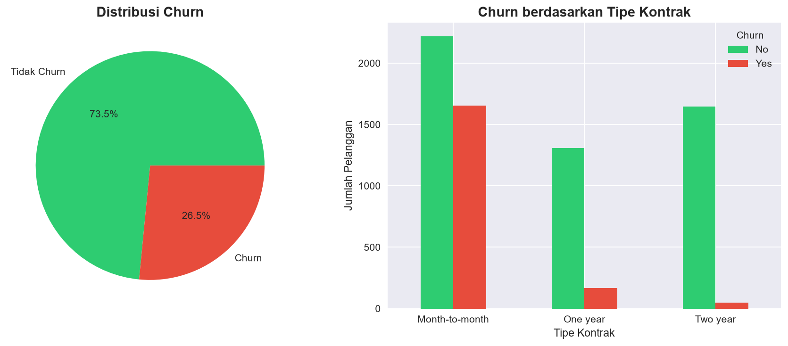
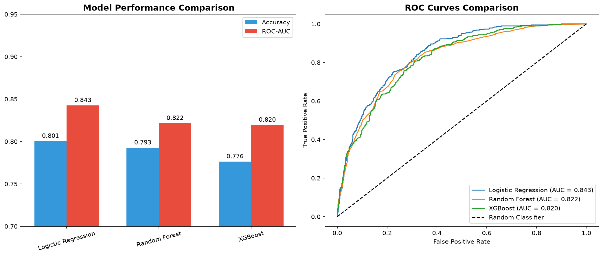

# 📊 Customer Churn Prediction

> **End-to-end Machine Learning project** untuk memprediksi pelanggan yang akan berhenti berlangganan (churn) menggunakan berbagai algoritma ML.


## 🎯 Problem Statement
Perusahaan telekomunikasi kehilangan pendapatan signifikan akibat customer churn. Proyek ini membangun model prediksi untuk mengidentifikasi pelanggan berisiko tinggi agar tim bisnis dapat mengambil tindakan proaktif.

## 📈 Key Results
| Model | Accuracy | ROC-AUC |
|-------|----------|---------|
| Logistic Regression | ~80% | ~0.84 |
| Random Forest | ~79% | ~0.83 |
| **XGBoost** | **~81%** | **~0.86** |

## 🔍 Key Findings
- Pelanggan dengan **kontrak month-to-month** 3x lebih mungkin churn
- **Tenure rendah** (< 12 bulan) adalah prediktor churn terkuat
- **Fiber optic** users memiliki churn rate lebih tinggi

## 🛠️ Tech Stack
- **Python** — pandas, numpy
- **Visualization** — matplotlib, seaborn, plotly
- **Machine Learning** — scikit-learn, XGBoost
- **Environment** — Jupyter Notebook

## 📁 Struktur Proyek
```
customer-churn-prediction/ 
├── notebooks/ 
│ 
├── 01_EDA.ipynb # Exploratory Data Analysis 
│ 
├── 02_preprocessing.ipynb # Data Cleaning & Feature Engineering 
│ 
└── 03_modeling.ipynb # Model Training & Evaluation 
├── src/ 
│ 
├── data_processing.py # Utility functions 
│ 
└── model.py # Model classes 
├── outputs/figures/ # Saved plots & visualizations 
└── requirements.txt
```
## 📊 Visualizations

### 1. Churn Distribution & Overview


### 2. Model Performance & ROC Curves


---

## 👩‍💻 Author
**Irene**
- **GitHub:** [@irene120304](https://github.com/irene120304)
- **LinkedIn:** [linkedin.com/in/irene](https://www.linkedin.com/in/irene-margareth-0329073b3/)
- **Target Role:** Data Scientist | Machine Learning Engineer | Data Analyst

## 🚀 How to Run
```bash
# Clone repo
git clone https://github.com/irene120304/customer-churn-prediction
cd customer-churn-prediction

# Install dependencies
pip install -r requirements.txt

# Download dataset dari Kaggle
# https://www.kaggle.com/datasets/blastchar/telco-customer-churn
# Simpan CSV ke folder data/

# Jalankan notebooks secara berurutan
jupyter notebook
